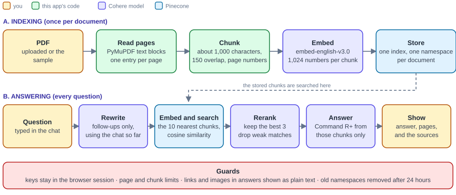

# RAG Document QA

[](https://rag-document-app-mini-project.streamlit.app/)  

**Live demo:** https://rag-document-app-mini-project.streamlit.app/

The demo asks for your own Cohere and Pinecone API keys in the sidebar. They stay in your browser session and are not stored. Press "Use the sample PDF" to try it without a document of your own. Streamlit's free plan puts an app to sleep when nobody has used it for a while, so the first visit can take a moment.

Upload a PDF, ask questions, and get answers that come only from the document, with the pages they came from. It is a retrieve-and-rerank RAG app built with Cohere, Pinecone, PyMuPDF and Streamlit.



## What it does

- Reads a PDF page by page and splits it into sentence-aware chunks of about 1,000 characters, with 150 characters of overlap so a fact on a boundary is not cut in two. Every chunk remembers its page.
- Embeds the chunks with Cohere `embed-english-v3.0` and stores them in Pinecone. One index is shared, and each uploaded document gets its own namespace.
- For each question it embeds the question, fetches the 10 nearest chunks, reranks them with Cohere `rerank-english-v3.0`, and gives the best 3 to Command R+ with an instruction to answer only from them.
- Shows the answer with its sources: page numbers, relevance scores, and which chunks the model cited.
- Understands follow-up questions. When the chat already has earlier turns, a follow-up such as "and the overlap?" is first rewritten into a standalone question, and that is what gets searched.
- Treats the document as untrusted input. The model is told never to follow instructions found in a document, and links and images in answers are shown as plain text, because a hidden instruction in a PDF could otherwise try to carry data out through a markdown image address.

## What kind of RAG this is

Advanced RAG in the plain sense: the basic retrieve-and-generate loop plus a reranking step, with query rewriting for follow-up questions. It uses dense vector search only, makes one pass per question, and works on one document at a time. It is not hybrid search, not agentic and not graph based. [docs/how-it-works.md](docs/how-it-works.md) explains each step.

## Run it locally

You need Python 3.11 or newer, a [Cohere](https://dashboard.cohere.com/api-keys) API key and a [Pinecone](https://app.pinecone.io) API key. Both have free plans.

```bash
python -m venv .venv
source .venv/bin/activate        # on Windows: .venv\Scripts\activate
pip install -r requirements.txt
streamlit run app.py
```

Paste the two keys into the sidebar and press **Check keys**. Then press **Use the sample PDF** and ask "How many numbers are in an embedding?", or upload your own PDF.

To keep the keys out of the browser, copy `.streamlit/secrets.toml.example` to `.streamlit/secrets.toml` and fill it in. That file is ignored by git.

To check that your keys work with the exact calls this app makes, run this before you deploy. It stores the sample PDF in a temporary namespace, asks one question and deletes the namespace:

```bash
python scripts/live_check.py
```

## Deploy on Streamlit Community Cloud

1. Push this repository to your GitHub account.
2. On [share.streamlit.io](https://share.streamlit.io) choose **Create app**, pick the repository and the `main` branch, and set the main file to `app.py`.
3. Under **Advanced settings** choose Python 3.11.
4. Secrets are optional. Without them, every visitor pastes their own keys. With them (same format as `.streamlit/secrets.toml.example`) the app works straight away, but everyone who opens it spends your Cohere and Pinecone quota. Keep `RAG_MAX_QUESTIONS` set so one visitor cannot use it all.
5. Deploy. Apps on the free plan go to sleep when nobody has used them for a while, and the first visit afterwards takes a moment.

## Settings

Everything has a default and can be changed with an environment variable or a Streamlit secret. The sidebar also has sliders for the retrieval settings.

| Variable | Default | Meaning |
|---|---|---|
| `COHERE_API_KEY`, `PINECONE_API_KEY` | none | Built-in keys. Visitors can still paste their own. |
| `RAG_CHUNK_SIZE`, `RAG_CHUNK_OVERLAP` | 1000, 150 | Characters per chunk and characters repeated between neighbours. |
| `RAG_RETRIEVE_TOP_K`, `RAG_RERANK_TOP_N` | 10, 3 | Chunks fetched by vector search and chunks kept after reranking. |
| `RAG_MIN_RELEVANCE` | 0.0 | Reranked chunks scoring below this are dropped. If none are left the app says it found nothing. |
| `RAG_REWRITE_FOLLOWUPS` | true | Rewrite follow-up questions before searching. Costs one extra model call. |
| `COHERE_EMBED_MODEL`, `COHERE_RERANK_MODEL`, `COHERE_CHAT_MODEL` | `embed-english-v3.0`, `rerank-english-v3.0`, `command-r-plus-08-2024` | Model names. |
| `PINECONE_INDEX_NAME`, `PINECONE_CLOUD`, `PINECONE_REGION` | `rag-document-qa`, `aws`, `us-east-1` | The shared index. The free plan only offers AWS `us-east-1`. |
| `RAG_MAX_PAGES`, `RAG_MAX_CHUNKS` | 80, 600 | Largest PDF the app accepts. |
| `RAG_MAX_QUESTIONS` | 0 | Questions per session when the built-in keys are used. 0 means no limit. |
| `RAG_NAMESPACE_TTL_HOURS` | 24 | Namespaces older than this are removed after the next upload. |

## Project layout

```
app.py                     the Streamlit page
rag/
  config.py                settings and their environment variables
  pdf.py                   PyMuPDF reader, one entry per page
  chunking.py              sentence-aware chunks with overlap and page numbers
  cohere_service.py        embeddings, rerank, grounded answer, follow-up rewrite, retries
  vector_store.py          Pinecone index, namespaces, search, clean-up of old namespaces
  pipeline.py              ingest(pdf) and ask(question)
  errors.py                plain-language explanations of Cohere and Pinecone errors
  render.py                shows model output without live links or images
  prompts.py, keys.py
tests/                     offline tests with in-memory fakes of Cohere and Pinecone
eval/                      retrieval and answer check you can run on your own questions
scripts/                   live_check.py, make_sample_pdf.py
samples/how-rag-works.pdf  the document behind the "Use the sample PDF" button
```

## Tests

```bash
pip install -r requirements-dev.txt
python -m pytest
```

The tests run offline. Cohere and Pinecone are replaced by small in-memory fakes, and the fake embedding is a hashed bag of words, so a test can check that the right chunk is retrieved and not only that a call was made. The Streamlit page itself is driven with Streamlit's `AppTest`.

What the tests cannot show is that your live keys work. That is what `scripts/live_check.py` is for.

## Evaluating retrieval

```bash
python -m eval.run_eval --pdf your.pdf --questions your-questions.json --top-k 10 --top-n 3
```

Each question in the JSON file has `question`, `expect` (text that must appear in the passage that answers it), and optionally `page` and `answer_contains`. For every question the script reports whether the expected passage was found by vector search, whether it survived reranking, whether a kept chunk is on the right page, and whether the answer contains the expected text. See `eval/questions.sample.json`. The sample PDF is tiny, so use a small `--top-k` with it or run it on your own documents.

No evaluation numbers are published here. The script is there so that any figure you quote comes from your own questions.

## Design notes

- **One index, one namespace per document.** The first version created a new Pinecone index for every upload. Free plans allow only a few indexes, and closing the tab left the index behind. Namespaces are cheap, the Clear button deletes the document's namespace, and old ones are removed after 24 hours.
- **Overlap and page numbers in the chunker.** Splitting at every full stop cut a sentence apart at "e.g." and "Fig. 3". Splitting on sentence ends that skip common abbreviations, and carrying the last sentences into the next chunk, keeps a fact whole. The page range of a chunk comes from its new sentences only, so repeated overlap text does not widen it.
- **Rerank after search.** Vector search is fast but rough. The reranker reads the question and each candidate together, so it is slower and sharper, and it only has to look at ten chunks.
- **Cohere's `documents` field.** The chunks go in as documents, which is the chat endpoint's built-in RAG mode. It lets the model cite the chunks it used. The chat call is the v1 endpoint, which is what the original project used. Moving to Cohere's v2 API and Command A is the obvious next step.
- **Keys.** Keys typed in the sidebar live in the browser session and are never written to disk or logged. Error messages are scrubbed of anything that looks like a key.

## Limits

- Text PDFs only. A scan has no selectable text and needs OCR first.
- Tables are read as a stream of words and lose their layout.
- The default embedding model is English. A multilingual model needs a different `COHERE_EMBED_MODEL` and a matching index dimension.
- One document at a time. The free plans of Cohere and Pinecone have rate and storage limits.
- The answer is only as good as the chunks that were retrieved. The reranker score is a hint, not a guarantee.

## Where it came from

This started as the week 7 project of the Celebal Technologies internship, which is still in [celebal_Internship](https://github.com/SahilYadav-op/celebal_Internship/tree/main/assignments/week7_rag_project). The first version followed the structure of [VivekChauhan05/RAG_Document_Question_Answering](https://github.com/VivekChauhan05/RAG_Document_Question_Answering). This repository is a rewrite as a project of its own, with overlap and page-aware chunking, a shared index with namespaces, citations, a grounding instruction, follow-up questions, tests and CI.

## Author

Sahil Yadav, [GitHub](https://github.com/SahilYadav-op)

## Licence

MIT, see [LICENSE](LICENSE).
